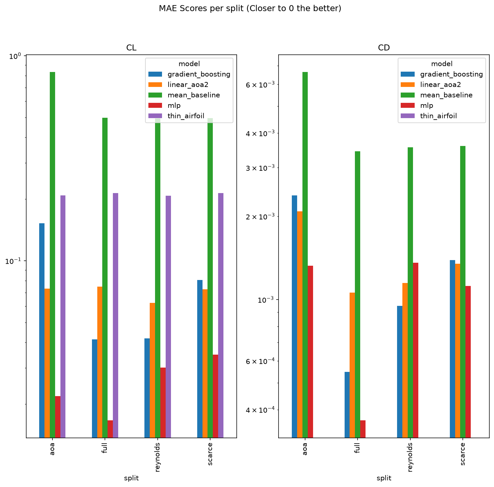
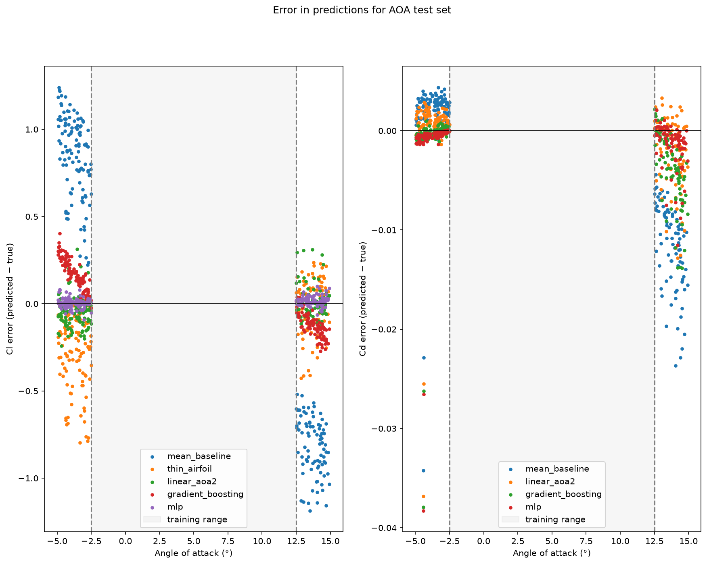
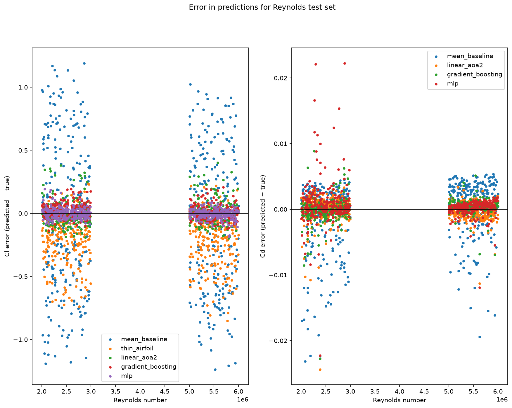

# Airfoil Surrogate Model
Machine Learning models that predict an airfoil's lift and drag coefficients from its shape, angle of attack and reynolds number, trained on 1000 CFD simulations. The best model (an MLP - multi layer perceptron) predicts lift with a R^2 score of 0.998 and a drag R^2 score of 0.980 on held-out test airfoils. This project also explored where each model breaks down when extrapolating data outside its training range.

## The Problem
CFD is accurate but slow and expensive to run. When engineers are designing a wing, they want to try thousands of different shape and angle combinations. However running a CFD simulation for each of those iterations would not be practical.

Therefore the idea behind this surrogate model is to train a Machine learning model on simulations that have already been run with the goal of predicting the coefficient of lift and drag in milliseconds for each new airfoil, angle of attack and Reynolds number without using a CFD simulation while retaining accuracy and reliability.

## Data
For this I used the AirfRANS dataset containing:
- 1000 2D RANS simulations
- NACA 4- and 5- digit airfoils
- Re 2-6 million
- Angle of Attack (aoa) -5° to 15°

The dataset contains multiple splits used for training and extrapolating data:
- `full`:(800 train, 200 test) the interpolation test and normal case.
- `scarce`: (200 train, 200 test) the same 200 test airfoils as full split
- `aoa`: (804 train, 196 test) training on simulations with aoa range -2.5° to 12.5°, testing on simulations outside that range. Used to test extrapolation of models (notebook 05)
- `reynolds`: (504 train, 496 test) training on simulations with Re range 3-5 million, testing on simulations outside that range. Used to test extrapolation of models (notebook 05)

## Approach
1. Data pipeline: downloaded and validated the AirfRANS data validating it and building my own calculations for lift and drag by integrating the pressure graph and the segment pressure (notebook 01). My pressure lift coefficient matched the library’s to within 4×10⁻⁵ across all 1,000 simulations (pressure drag: median +3.6%). Models were trained on the library’s total coefficients, which include skin-friction drag.
2. Features: The data included both 4- and 5- digit airfoil, so for the models to accurately use all the data, I had to convert each airfoil description into universal values (features.py): `max_camber`,`camber_pos`,`thickness`,`reflex`. 
3. Models: Once the data is in a universal form, I went through each model calculating the R^2, MAE and RMSE scores for each:
   - Baseline: Mean, Thin airfoil theory 
   - Linear: Linear regression (with additional investigatory runs with/out aoa and aoa^2)
   - Trees: Random Forest and Gradient Boosting
   - MLP: again exploring multiple seeds, models for both target coefficients or one, mean of multiple seeds (results are an average of 10 networks to minimise the effect of an unlucky seed)
4. Evaluation: Conducted cross validation tests, averaging out multiple MLP seeds, Tested each model for extrapolation accuracy through retraining and testing every model on the `scarce`,`aoa` and `reynolds` splits.

## Results
R^2 and MAE scores per model (full set):
| model             |    cl_r2 |   cl_mae |     cd_r2 |    cd_mae |
|:------------------|---------:|---------:|----------:|----------:|
| mean_baseline     | -0.00201 |  0.49825 |  -0.0011  |   0.00343 |
| thin_airfoil      |  0.74281 |  0.21423 | ---       | ---       |
| linear_aoa2       |  0.96762 |  0.07477 |   0.9041  |   0.00106 |
| gradient_boosting |  0.99018 |  0.04137 |   0.96523 |   0.00055 |
| mlp               |  0.99843 |  0.01667 |   0.98047 |   0.00037 |

(MLP: average of 10 networks)

CL MAE scores per split:
| model             |    full |   scarce |   reynolds |     aoa |
|:------------------|--------:|---------:|-----------:|--------:|
| mean_baseline     | 0.49825 |  0.49753 |    0.49553 | 0.83346 |
| thin_airfoil      | 0.21423 |  0.21423 |    0.20767 | 0.20812 |
| linear_aoa2       | 0.07477 |  0.07260 |    0.06226 | 0.07325 |
| gradient_boosting | 0.04137 |  0.08053 |    0.04181 | 0.15244 |
| mlp               | 0.01667 |  0.03491 |    0.03020 | 0.02192 |

CD MAE scores per split:
| model             |      full |    scarce |   reynolds |       aoa |
|:------------------|----------:|----------:|-----------:|----------:|
| mean_baseline     |   0.00343 |   0.00359 |    0.00356 |   0.00665 |
| linear_aoa2       |   0.00106 |   0.00135 |    0.00115 |   0.00209 |
| gradient_boosting |   0.00055 |   0.00139 |    0.00095 |   0.00238 |
| mlp               |   0.00037 |   0.00112 |    0.00136 |   0.00133 |



The above graph shows the MAE (Mean Absolute Error) per model for both the coefficient of Lift (CL) and Drag (CD). the key points are for CL, the MLP performs best across all splits with whereas for CD, on the initial view MLP again is the best performing model, it struggles relatively compared to gradient boosting for the reynolds split.


The above graph shows the extrapolation from training the models on the `aoa` set. Again, we clearly see for CL(Left) the MLP (purple) performs the best with its points being close to 0, similarly for CD(right) for low AOA (MLP now being red). However, for higher AOA, every models predictions become more spread out, generally predicting too low with a rough downwards curve appearing.

Its also worth noting the 2 large errors on the low AOA side where every model is affected. This is because within the dataset, the low AOA contains these 2 airfoils that are suspected to have flow separation resulting in high drag, compared to the low drag of the other simulations.


The above graph is the extrapolation from training the models on the `reynolds` set. Much like the AOA set, for CL the MLP(purple) performs the best with prediction errors being close to 0, However For CD, at High Re values (>5 million) The MLP(red) performs well, with predictions being close to 0. But for low Re values (<3 million) the MLP's predictions are for the most part an overestimate but the general spread is much larger. as a result the gradient boosting (green) does perform much better for this (MAE of 0.00095) and that can be seen in the graph with the green points not being nearly as spread as the red.

## Key Findings
- The MLP is the most accurate model on the normal (`full`) split: CL R^2: 0.998 (MAE 0.017) and CD R^2: 0.980 (MAE 0.00037), averaged over 10 networks followed by gradient boosting
- Tree models fail at extrapolating angles of attack: On the `aoa` split, gradient boostings CL error rose 3.7x (MAE 0.041-0.152), because trees predict a flat value beyond the range. The MLP (0.017-0.022) and the linear model (no change) carried on following the trend
- MLP failed at extrapolating unseen reynolds numbers: Gradient boosting was best (MAE 0.00095) and MLP was worse (0.00136), with the MLP over-predicting drag at low Re. Re only weakly affects drag within the training range so a tree models flat prediction was best suited.
- So no single model is best everywhere, with the physical behaviour outside of training range affecting the best suited model for that extrapolation.
- The raw reynolds number (~10^6) and the geometry features (~10^-2) had a large difference in scale made the fit badly conditioned, so the geometry features weights came out as: ~0. rescaling the Re took the CL R^2 for linear regression from 0.87 to 0.968
- Among thin airfoils at negative AOA, 2 of 12 have 4-5x the drag of the others, most of it being pressure drag, which is consistent with the flow separating (inferred). These are the two outliers in the AOA cd error graph.

## Limitations
- 2D: The largest limitation is the simulations are only modelled in 2 dimensions and 4/5 digit shapes only.
- RANS CFD is least reliable for separated flow
- Skin-friction drag comes from the dataset library's calculation
- Neural Network trained on 640 airfoils (160 held for validation) vs 800 for tree models 
- MLP results are a 10-network average, while other models are single runs.

## How to reproduce
Tested with Python 3.11 on Windows
(MLP results may vary in the last decimal place across machines)

### 1. Set up Environment
```bash
git clone https://github.com/Will-Bonnett/airfoil-surrogate
cd airfoil-surrogate
python -m venv .venv
.venv\Scripts\Activate.ps1
# source .venv/bin/activate
pip install -r requirements.txt
```

### 2. Quick start: use the included table
The processed table of all 1,000 simulations is committed at `data/processed/airfrans_coefficients.csv`, so notebooks 02-05 run without downloading the raw dataset. Open the notebooks with Jupyter:

```bash
jupyter notebook
```
then open `notebooks/` in the browser tab that appears and run them in order (01–05).
Alternatively, open them in VS Code and select the `.venv` interpreter as the kernel.

### 3. Full Pipeline from the raw data (optional)
Needed only for notebook 01 and to rebuild the table yourself

```bash
# Download dataset
curl -L -C - -o data/Dataset.zip https://data.isir.upmc.fr/extrality/NeurIPS_2022/Dataset.zip

python src/prepare_data.py # verifies the zip, then extracts it
python src/validate_data.py # checks all 1,000 simulations load cleanly
python src/build_table.py # rebuilds the csv
```
On Windows Powershell, use `curl.exe` rather than `curl`

### 4. run the tests
```bash
pytest
```

## Repository Structure
```
├── data/
│   └── processed/airfrans_coefficients.csv   # one row per simulation (inputs, Cl/Cd, splits)
├── notebooks/
│   ├── 01_explore.ipynb        # data exploration, Cp plots, own force calculation
│   ├── 02_baseline.ipynb       # mean, thin-airfoil theory, linear regression
│   ├── 03_tree_models.ipynb    # random forest, gradient boosting, cross-validation
│   ├── 04_mlp.ipynb            # PyTorch MLP, multi-seed experiments
│   └── 05_evaluation.ipynb     # all models on all four splits (extrapolation)
├── results/
│   ├── *.csv                   # metrics for each stage
│   └── figures/                # plots used in this README
├── src/
│   ├── prepare_data.py         # verify and extract the raw dataset
│   ├── validate_data.py        # check every simulation loads cleanly
│   ├── parse_name.py           # simulation name -> inputs (speed, angle, NACA parameters)
│   ├── forces.py               # pressure integration -> Cl, Cd
│   ├── physics.py              # Reynolds number and constants
│   ├── build_table.py          # build the per-simulation CSV
│   ├── features.py             # common geometric features for 4- and 5-digit NACA airfoils
│   ├── models.py               # one fit/predict function per model
│   ├── mlp.py                  # MLP building blocks (data prep, network, training)
│   └── evaluation.py           # metrics and plotting helpers
├── tests/                      # pytest tests for parsing, forces and features
├── requirements.txt
└── README.md
```
## Next Steps
- Measure the uncertainty within the MLP as a large disagreement would mean unreliable predictions
- Use the surrogate models to search thousands of shapes for the best lift-to-drag ratio / best lift for a given drag
- Run the designs through XFOIL or other CFD simulations and compare to the models predictions

Open Questions:
- Are those two outliers in negative AOA actually flow separation?
- Why does the MLP over-predict drag at low Reynolds numbers? (Rescaling Re to log(Re) made it worse).